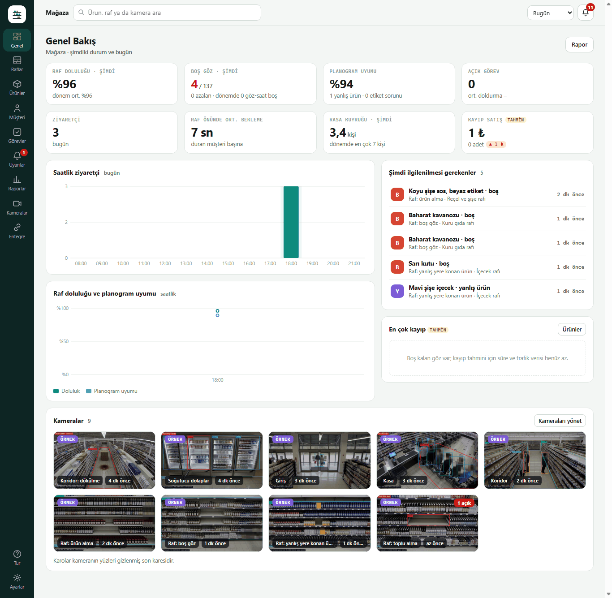
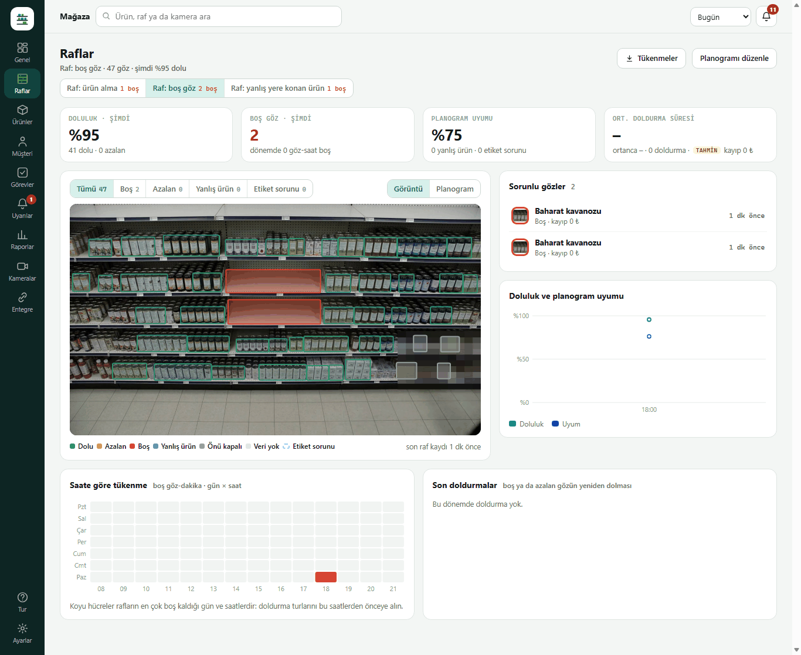
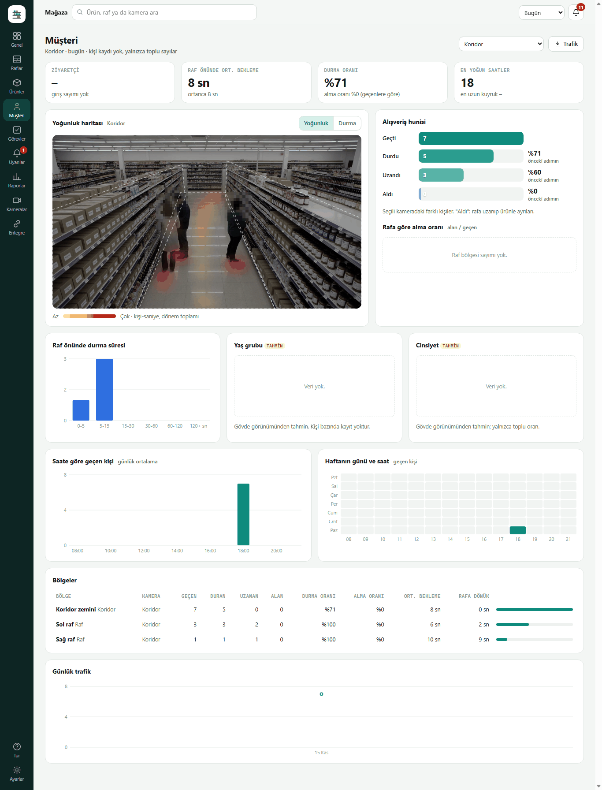
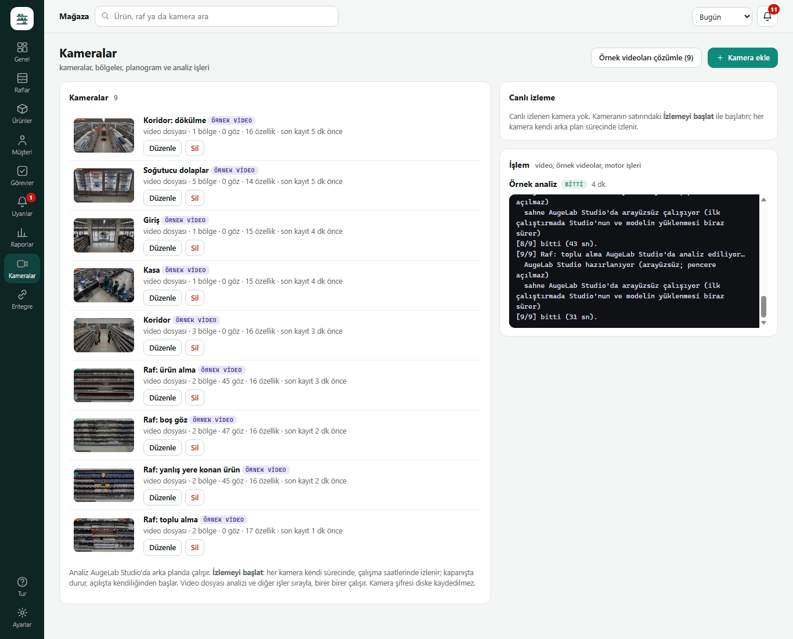
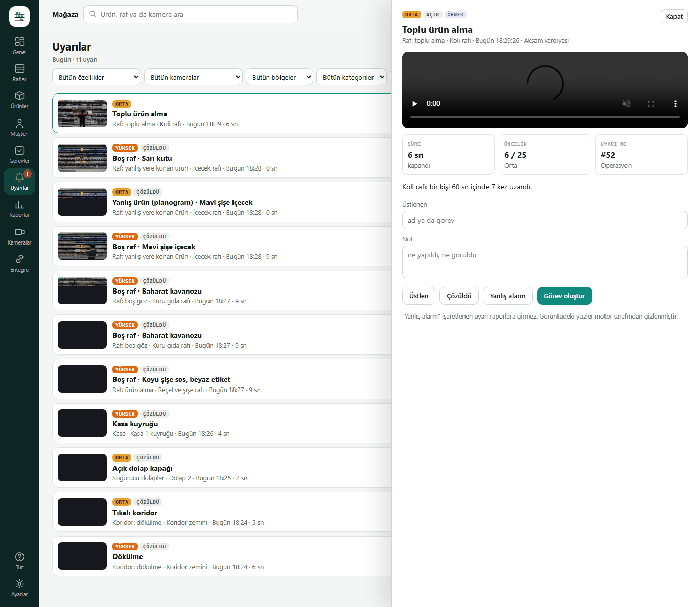
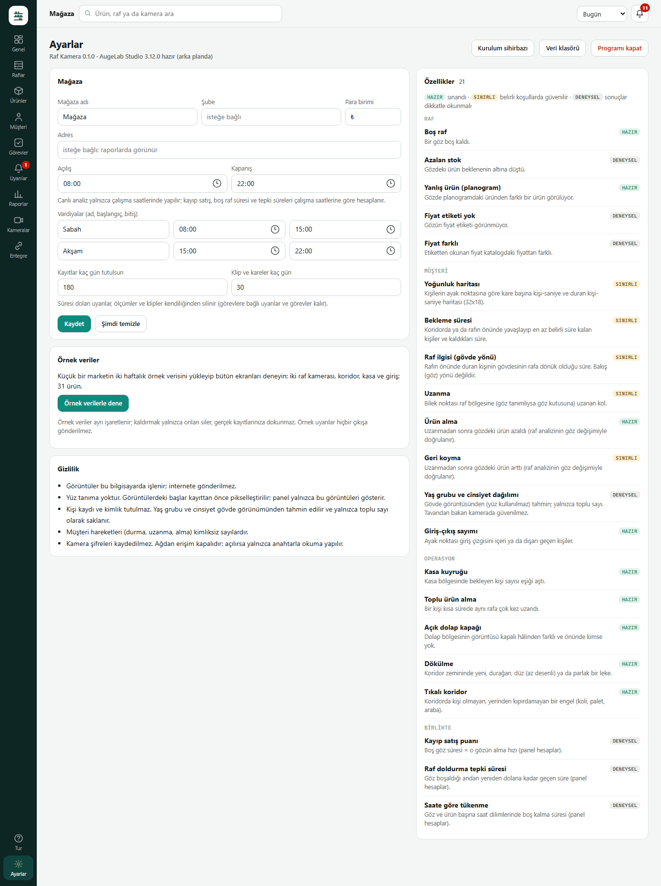

# Raf Kamera

Raf Kamera, mağazanın mevcut kameralarından rafları ve müşteri hareketini izler. Hangi rafın boş kaldığını, hangi gözden
ürün alındığını, rafın önünde kaç kişinin durduğunu, kasada kuyruğun ne kadar uzadığını bir panelde gösterir; uyarılardan
personel görevi açar ve rapor verir. Amaç mağaza sahibinin mağazada ne olduğunu görmesidir.

- Görüntüdeki kişilerin başları pikselleştirilir; yüz tanıma yoktur.
- Kişiler tanınmaz; kimlik ya da kişiye bağlı kayıt tutulmaz. Müşteri hareketleri kimliksiz, toplu sayılar olarak saklanır.
- Görüntü diske yalnızca şu durumlarda yazılır: uyarı oluştuğunda o ana ait kısa klip ve kare, her kameranın son karesi
  ve sizin kaydettiğiniz raf referans karesi. Diske yazılan her karede başlar önce pikselleştirilir. Kayıtların ve
  kliplerin kaç gün tutulacağını **Ayarlar**'dan siz belirlersiniz.
- Her şey sizin bilgisayarınızda çalışır; görüntü internete gönderilmez.

<p align="center">
  <a href="https://github.com/lyunusl/raf-kamera/releases/latest/download/RafKamera-Kurulum-0.1.0.exe">
    
  </a>
  <br>
  <sub>Windows 10/11 (64 bit) · <a href="https://github.com/lyunusl/raf-kamera/releases/latest">Sürüm notları</a></sub>
</p>

> **İlk sürüm (0.1.0).** Özellikler yalnızca programla gelen dokuz örnek klipte sınandı; gerçek bir mağazada henüz
> denenmedi. Ayrıntılar [Özellikler ve durumları](#özellikler-ve-durumları) bölümündedir.



## Neler yapabilirsiniz?

- **Kamera veya video ekleyin.** IP kamera, kayıt cihazı (RTSP ya da ONVIF), HTTP akışı ya da video dosyası.
- **Bölgeleri ve rafları çizin.** Kameranın karesinde raf, koridor, kasa, soğutucu dolap ve giriş bölgelerini çizin. Rafı
  gözlere bölün (**Gözleri otomatik bul** öneri verir), her göze ürününü ve fiyatını atayın, raf doluyken
  **Rafı dolu olarak kaydet** ile referans karesini alın.
- **Rafları izleyin.** Boş göz, yanlış yere konan ürün, gözden alınan ve geri konan ürünler, doluluk ve planogram uyumu.
- **Müşteri hareketini görün.** Yoğunluk haritası, geçti → durdu → uzandı → aldı hunisi, raf önünde bekleme süresi,
  giriş-çıkış sayımı.
- **Mağaza işlerini takip edin.** Kasa kuyruğu, açık bırakılan dolap kapağı, zemindeki dökülme, koridoru tıkayan koli ya da
  palet. Uyarılar personel görevini kendiliğinden açar; durum düzelince görev kapanır ve tepki süresi yazılır.
- **Rapor alın.** Dönemi önceki dönemle karşılaştırın; Excel ve CSV olarak dışa aktarın.
- **Uyarıları iletin.** Webhook, Slack, Microsoft Teams, MQTT, Modbus TCP, OPC UA ve e-posta. Çıkışlara yalnızca olayın
  metin bilgileri gider, görüntü gitmez.



## Özellikler ve durumları

Durumlar programla gelen **dokuz örnek klipten** gelir. Klipler yapay zekâ ile üretilmiş, her biri 10 saniyelik mağaza
görüntüleridir; gerçek bir mağazadan alınmamıştır. Hepsi AugeLab Studio'da arka planda (pencere açılmadan), panelin
**Örnek videoları çözümle** düğmesiyle çözümlendi. Bölgeler, gözler ve süre ayarları bu kliplere göre yapıldı.
**Uygulama gerçek bir mağazada henüz denenmedi.**

- **Hazır**: örnek kliplerde doğru sonuç verdi.
- **Sınırlı**: örnek kliplerde kısmen doğru.
- **Deneysel**: örnek kliplerde çalıştığı gösterilmedi.

Panel aynı durumları **Ayarlar → Özellikler** altında gösterir.

| Özellik | Ne yapar | Durum | Örnek kliplerde |
|---|---|---|---|
| Boş raf | Bir gözün boş kaldığını bildirir | Hazır | Boş 5 gözün 5'i bulundu; dolu gözde yanlış uyarı yok |
| Azalan stok | Gözdeki ürün beklenenin altına düşünce uyarır | Deneysel | Kavanozları azalan göz klip bitmeden "az" olmadı |
| Yanlış ürün (planogram) | Gözde planogramdakinden farklı ürün görülünce uyarır | Hazır | 1/1, yanlış uyarı yok (tek örnek) |
| Fiyat etiketi yok | Gözün fiyat etiketi görünmeyince uyarır | Deneysel | Kliplerde etiketler okunacak boyutta değil, sınanmadı |
| Fiyat farklı | Etiketten okunan fiyat katalogdakinden farklıysa uyarır | Deneysel | Kliplerde sınanmadı |
| Yoğunluk haritası | Kişilerin durduğu ve geçtiği yerleri gösterir | Sınırlı | Koridorda 5 kişi 7 iz sayıldı |
| Bekleme süresi | Rafın ya da koridorun önünde duran kişileri ve sürelerini sayar | Sınırlı | Duran 6 müşterinin 5'i bulundu |
| Raf ilgisi (gövde yönü) | Gövdenin rafa dönük kaldığı süre (bakış yönü değil) | Sınırlı | Süre yazılıyor, saniye düzeyinde doğrulanmadı |
| Uzanma | Rafa uzanan kolu sayar | Sınırlı | Gerçek uzanmalar bulundu; birkaç kısa fazladan uzanma var |
| Ürün alma | Uzanmadan sonra gözdeki ürün azaldıysa alma sayar | Hazır | 3/3 doğru gözde, sahte alma yok |
| Geri koyma | Uzanmadan sonra gözdeki ürün arttıysa geri koyma sayar | Sınırlı | 1/1 doğru, 1 sahte geri koyma |
| Yaş grubu ve cinsiyet | Gövde görüntüsünden toplu tahmin | Deneysel, **varsayılan kapalı** | Güvenilmez: kasa klibindeki kadınların hiçbiri kadın sayılmadı |
| Giriş-çıkış sayımı | Giriş çizgisini geçenleri sayar | Hazır | Giren 3/3, çıkan 2/2 |
| Kasa kuyruğu | Kasada bekleyen kişi sayısı eşiği aşınca uyarır | Hazır | En uzun kuyruk 7 (gözle 7), uyarı 1/1 |
| Toplu ürün alma | Bir kişi kısa sürede aynı rafa çok kez uzanınca uyarır | Hazır | Uyarı 1/1; yaklaşık 9 alıştan 7'si sayıldı |
| Açık dolap kapağı | Açık bırakılan soğutucu dolap kapağını bildirir | Hazır | 1/1, diğer dolaplarda uyarı yok |
| Dökülme | Koridor zeminindeki yeni lekeyi bildirir | Hazır | 1/1 |
| Tıkalı koridor | Koridorda duran koli, palet ya da arabayı bildirir | Hazır | 1/1 |
| Kayıp satış puanı | Boş göz süresi × o gözün alma hızı (panel hesaplar) | Deneysel | 10 saniyelik veride anlamlı değil |
| Raf doldurma tepki süresi | Göz boşaldığı andan yeniden dolana kadar geçen süre | Deneysel | 10 saniyelik veride anlamlı değil |
| Saate göre tükenme | Göz ve ürün başına saat dilimlerinde boş kalma süresi | Deneysel | 10 saniyelik veride anlamlı değil |

Bilmeniz gerekenler:

- **Yaş grubu ve cinsiyet tahmini güvenilir değildir** ve varsayılan olarak kapalıdır. Yüz kullanılmaz, gövde görüntüsünden
  tahmin edilir ve yalnızca toplu sayı olarak tutulur. Tavandan bakan kamerada sonuçlar daha da kötüdür.
- **Fiyat etiketi okuma deneyseldir.** Etiketin kameraya yakın ve yüksek çözünürlüklü görünmesi gerekir; örnek kliplerdeki
  etiketler bunun için fazla küçüktü. Fotoğraflarla yapılan denemede ondalık ayırıcı ve üstte yazılan kuruş hanesi sık
  yanlış okundu; "₺" işareti okunamaz ("TL" okunur).
- Açık dolap kapağı ve dökülme, kayıtlı bir referans karesi ister (kapakları kapalı dolap, boş koridor).
- Müşteri sayıları kişiler birbirini örttüğünde bölünebilir (bir kişi iki iz sayılır); kısa duraklamalar kaçabilir.
- "Aldı" satış değildir: hangi gözden kaç kez ürün alındığını sayar.



## Nasıl çalışır?

1. **Kamera** → Kamera akışını ya da video dosyasını ekleyin.
2. **Bölgeler ve raf gözleri** → Karede bölgeleri çizin, rafı gözlere bölüp ürünleri atayın.
3. **Analiz** → Görüntüyü bilgisayarınızdaki **AugeLab Studio** arka planda işler; Studio penceresi hiç açılmaz. Her kamera
   kendi arka plan sürecinde çalışır.
4. **Panel** → Uyarılar, görevler, raf ve müşteri ekranları ile raporlar tarayıcınızda açılan panelde görünür
   (`http://127.0.0.1:8800`).

**Örnek videolar.** Programla dokuz örnek klip (raf, koridor, kasa, giriş, soğutucu dolap, dökülme) ve hazır kamera
ayarları gelir. **Kameralar → Örnek videoları çözümle** hepsini sırayla AugeLab Studio'da çözümler (ölçüm yapılan
bilgisayarda yaklaşık 5 dakika sürdü) ve ekranları gerçek sonuçlarla doldurur. Yalnızca ekranlara bakmak isterseniz
**Örnek verilerle dene** küçük bir marketin iki haftalık örnek verisini yükler; örnek veriler ayrı tutulur ve tek tıkla
kaldırılır.

**Canlı izleme.** Canlı kameranın satırındaki **İzlemeyi başlat** düğmesine bir kez basmanız yeterlidir. Kamera çalışma
saatlerinde izlenir, kapanışta durur, ertesi açılışta kendiliğinden yeniden başlar. Siz durdurursanız kendiliğinden
başlamaz. Çalışma saatleri **Ayarlar**'dan değiştirilir.





## Kurulum

Yukarıdaki **Windows için indir** düğmesiyle kurulum dosyasını indirip çalıştırın. Kurulum adım adım ilerler:

1. **Raf Kamera** bu kullanıcı için kurulur (yönetici izni gerekmez).
2. **Modeller**: 8 dosya (7 model ve etiket okuyucunun karakter listesi, toplam yaklaşık 124 MB) Google Drive'dan
   indirilir ve her biri SHA-256 özetiyle doğrulanır. İndirme olmazsa kurulum yine tamamlanır; Raf Kamera ilk açılışta
   eksik modelleri kendisi indirir.
3. **AugeLab Studio** kurulu değilse resmî kurulum dosyası indirilir, doğrulanır ve sessizce kurulur. Visual C++ bileşeni
   eksikse Microsoft'tan kurulur; Windows izin sorabilir.
4. **AugeLab hesabı**: hesabınız yoksa düğmeyle tarayıcıda oluşturun ve e-postanıza gelen bağlantıyla onaylayın.
5. **Lisans kodu**: hesabınızdaki lisans kodunu yapıştırın. Kod, Studio penceresi açılmadan Studio'ya kaydedilir;
   Raf Kamera onu saklamaz.

Kurulum bitince Raf Kamera açılır ve panel tarayıcınızda görünür. Bir adımı atladıysanız **Ayarlar → Kurulum sihirbazı**
aynı adımları gösterir.

**Gerekenler**

- Windows 10 ya da 11, 64 bit.
- AugeLab hesabı (kurulum sihirbazının belirttiği gibi ücretsiz Community planı yeterlidir) ve hesabınızdaki lisans kodu.
  Analiz, etkin lisanslı AugeLab Studio'da yapılır.
- İlk kurulum, model indirme ve lisans etkinleştirme için internet.

Program
`%LOCALAPPDATA%\Programs\RafKamera` altına, kameralar, olaylar, klipler ve indirilen modeller
`%LOCALAPPDATA%\RafKamera` altına konur. Program kaldırılınca bu veriler silinmez.

## Donanım

Aşağıdaki sayılar **tek bir bilgisayarda** (Intel i9-13900HX, 32 mantıksal çekirdek) üç canlı kamera aynı anda
izlenirken, kamera başına 60 saniye ölçüldü. Mağaza bilgisayarları genellikle daha zayıftır; sayıları alt sınır olarak
okuyun.

| Kamera | İşlemci | Bellek (çalışma kümesi / özel) | Analiz hızı |
|---|---|---|---|
| Koridor (müşteri) | yaklaşık 3,8 çekirdek | 948 MB / 2,4 GB | saniyede 3,7 kare |
| Kasa | yaklaşık 3,1 çekirdek | 880 MB / 2,4 GB | saniyede 3,8 kare |
| Raf (45 göz, ürün modelleriyle) | yaklaşık 5,1 çekirdek | 2,0 GB / 3,9 GB | saniyede 4,1 kare |

Her kamera ayrıca yaklaşık 20 MB'lık bir denetleyici süreç kullanır. Program varsayılan olarak aynı anda en çok 8 canlı
kamerayı izler.

## Gizlilik ve veri

- Yüz modeli ve yüz tanıma yoktur. Diske yazılan ve panelde gösterilen her karede, algılanan kişilerin başları
  pikselleştirilir. Kişi dedektörünün kaçırdığı biri olursa onun yüzü gizlenmez.
- Kişi kaydı ve kimlik tutulmaz. Müşteri hareketleri (durma, uzanma, alma) kimliksiz sayılır; yaş grubu ve cinsiyet
  (açılırsa) yalnızca toplu sayıdır.
- Görüntüler bu bilgisayarda işlenir, internete gönderilmez. Çıkışlara yalnızca olayın metin bilgileri gider.
- Kamera şifreleri diske kaydedilmez. Ağdan erişim kapalıdır; açılırsa yalnızca anahtarla okuma yapılır.
- Uyarılar, ölçümler ve klipler ayarlardaki saklama süresi dolunca kendiliğinden silinir.



## Sınırlar

- Ayarlar ve eşikler dokuz üretilmiş klibe göre yapıldı; gerçek mağaza görüntüsüyle hiç sınanmadı. "Hazır" bu kliplerde
  doğru demektir. Kendi kameranızda bir süre izleyip sonuçları gözle karşılaştırın.
- Azalan stok kliplerde gösterilemedi; yalnızca örnek kliplerin döngüyle oynatıldığı canlı denemede uyarı verdi.
- Canlı akışta ürün alma doğrulanmadı: aynı canlı denemede 2,5 dakikada hiç "aldı" yazılmadı.
- Fiyat etiketi okuma ve fiyat karşılaştırma örnek kliplerde hiç sınanmadı.
- Bildirim ve kontrol çıkışları ikaz, kayıt ve bildirim içindir; emniyet ya da güvenlik sistemlerinin yerine kullanılmaz.

## Kaynak koddan geliştirme

Python 3.12 ve Windows x64 üzerinde, proje klasöründe:

```powershell
py -3.12 -m venv .venv
.venv\Scripts\python -m pip install -r requirements.txt -r requirements-gelistirme.txt
.venv\Scripts\python -m pip install --target motor\deps --no-deps onnxruntime==1.31.1
New-Item -ItemType Directory -Force motor\modeller | Out-Null
Copy-Item kurulum\community-modeller\* motor\modeller\
.venv\Scripts\python uygulama.py
```

Panel `http://127.0.0.1:8800` adresinde açılır (`--tarayici-yok` tarayıcıyı açmaz, `--port` başka port seçer). Veriler
kaynak koddan çalışırken `veri\` klasöründe, exe'de `%LOCALAPPDATA%\RafKamera` altında durur (`RAF_KAMERA_VERI` ile
değiştirilebilir). Analiz için AugeLab Studio kurulu ve lisanslı olmalıdır; panel Studio'yu açmaz, her kamera için
`python -m studio run` ile arka planda çalıştırır.

**Modeller.** Model paketinin küçük dosyaları `kurulum\community-modeller` klasöründedir: paket kimliği
(`community-paket.json`), modelleri AugeLab Studio'nun içinde açan bileşen (`goruntu-<kimlik>.dll`), bileşenin bağımlılık
bildirimleri (`RUST-NOTICES.txt`) ve etiket okuyucunun karakter listesi (`etiket-oku.txt`). Model dosyaları
(`*.onnx.isgm`) GitHub'a konmaz, Google Drive'dadır. Hangi dosyaların indirileceği `studio_kurulum.MODELLER`
tablosundadır (ad, boyut, SHA-256, Drive kimliği). Paket dosyaları `motor\modeller` altındayken panel eksik modeller için
bir indirme şeridi gösterir; dosyalar aynı klasöre indirilir ve boyut ile SHA-256 özetiyle doğrulanır. Tablo değişince `python kurulum\modeller_iss.py` ile kurulum dosyasının model listesi
(`kurulum\modeller.iss`) yeniden üretilir. Modellerin kaynakları ve lisansları [ATIFLAR.md](ATIFLAR.md) dosyasındadır.

**Hazır sahne.** Çalıştırılan sahne (`kurulum\sahne\raf-kamera.pmod`) depoda yoktur: sahne dosyası yalnızca Studio
penceresinden kaydedilir. Bir kez üretilir:

1. Studio'yu açın. MCP `127.0.0.1:8765` adresinde açık olmalıdır.
2. `.venv\Scripts\python kurulum\sablon.py` çalıştırın. Raf bloklarını Studio'ya kaydeder ve sahneyi yeni bir sekmede kurar:
   Raf Video → Raf Kişi → Raf Ürün → Raf Analiz.
3. Studio'da açılan sekmeyi **Dosya → Farklı Kaydet** ile `kurulum\sahne\raf-kamera.pmod` olarak kaydedin.

**Sınamalar** `egitim` klasöründedir ve Studio olmadan çalışır:

```powershell
.venv\Scripts\python egitim\dene_arayuzsuz.py
.venv\Scripts\python egitim\dene_motor_iskeleti.py
.venv\Scripts\python egitim\dene_kurulum.py
```

Özelliklerin durumu `motor\raf_motor\sinama.py` dosyasındadır; panel ve yukarıdaki tablo oradan gelir.

**Derleme.** EXE ve Windows kurulum dosyası PyInstaller ve Inno Setup ile `kurulum\derle.cmd` çalıştırılarak oluşturulur;
hazır sahne ya da model paketi yoksa derleme durur (`kurulum\derle.cmd duz` paketsiz geliştirme derlemesidir).

## Lisans

Raf Kamera'nın kodu GNU AGPL-3.0 lisanslıdır. AugeLab Studio ayrı lisanslı bir üründür. Modellerin ve diğer üçüncü taraf
bileşenlerin kaynakları ve lisansları [Atıflar](ATIFLAR.md) dosyasındadır. [Uygulama lisansı](LICENSE)
